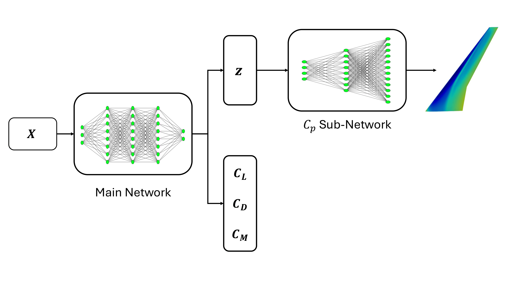

# Transonic wing aerodynamic analysis and uncertainty quantification using multi-task deep learning

This repository provides an open-source implementation of the multi-task surrogate models and hyperparameter optimization methods introduced in the work titled "**Transonic wing aerodynamic analysis and uncertainty quantification using multi-task deep learning**". This can be used to reproduce the results presented in the paper and use the methods for further research and development.

## Multi-task Aerodynamics Net (MTAeroNet)

This work introduces the Multi-task Aerodynamics Net (MTAeroNet) surrogate modeling architecture, which has a main network to predict integrated aerodynamic quantities and multiple sub-networks to predict various surface quantities for a three-dimensional body in transonic flow. A graphical overview of the modeling architecture is shown in the diagram below. In this implementation and work, each sub-network and the main network of the modeling architecture are MLP networks. This is done to promote simplicity within the modeling architecture while still maintaining prediction accuracy. 

<table border="0">
   <tr>
      

         
      

      <b>(a) MTAeroNet - $$C_p$$
      

         
      

      <b>(b) MTAeroNet - $$C_p$$
   </tr>
</table>

## Multiobjective Hyperparameter Optimization

This work also introduces a multiobjective optimization problem formulation for selecting the optimal hyperparameters for multi-task aerodynamic surrogate models. There are two objectives in the problem formulation. One objective is the mean of the normalized root mean square errors (NRMSE) in the integrated coefficients, and the other objective is the mean NRMSE in the surface quantities across the surface of the three-dimensional body in transonic flow. An open-source implementation of this formulation and its solution procedure is provided, which uses Optuna and Bayesian optimization with Tree-structured Parzen estimators to solve the optimization problem. Additionally, single objective optimization problem formulations and an implementation of their solution through Optuna is also provided for models that are not multi-task in nature but are also investigated in the work.  

# Installation and setup

The best way to run the implementation is through a conda environment. Miniconda is the recommended way to create a new conda environment with a Python installation that has a version of at least 3.12. Follow the steps below to create the new conda environment and use this implementation. 

1. Create a new conda environment and activate it.

   `conda create -n your_ev python=3.12`

2. Download the latest release of the code as a zip file and include it in your working directory.

3. Install the requirements for the environment using the requirements.txt file provided.

   `pip install -r requirements.txt`

The relevant code and implementations for the methods are located in the `src` folder in the repo. Individual runscripts for the hyperparameter optimization, model evaluation and uncertainty quantification are also provided to run the models on the wing geometry dataset with ease. In the `src` folder, the `MTAeroNet` class corresponds to the MTAeroNet - $$C_p$$ model and the `MHAeroNet` class corresponds to the MTAeroNet - $$C_p$$ and $$C_f$$ model from the paper.    

# Common Research Model wing dataset

# Running the code

The code to train and evalaute the models can be run using a few simple commands from a terminal or in a jobscript on a high-performance computing environment. These commands must be run from the root directory of the code that can be downloaded from the latest release.  

1. Running the hyperparameter optimization script. This requires specifying the number of training samples to be used for the model, the modeling method, the type of optimization, the number of trials and the random seed. In the associated publication, the seed values from 1 to 5 are used to run 5 different sets of the optimization. An example of the running command for this script is given below.

   `python runscript_hpo_crm_wing.py --samples 50 --method "mhaero" --type "multi" --trials 450 --seed 1`
   
2. Running the model prediction/evaluation script. This requires specifying the number of training samples to be used for the model and the method. The script runs the training with 10 different random initializations and using the results from all 5 hyperparameter sets leading to a total of 50 model evaluations. The training seeds used are from 1 to 10. An example of the running command for this script is given below.

   `python runscript_prediction_crm_wing.py --samples 50 --method "mhaero"`

3. Running the uncertainty quantification script. This only requires specifying the number of training samples used to train the model, as by default this runs the MTAeroNet - $C_p$ and $C_f$ model (which corresponds to the MHAeroNet class). An example of the running command for this script is given below. 

   `python runscript_uq_crm_wing.py --samples 50`

# Citation 

(ADD PAPER CITATION)

