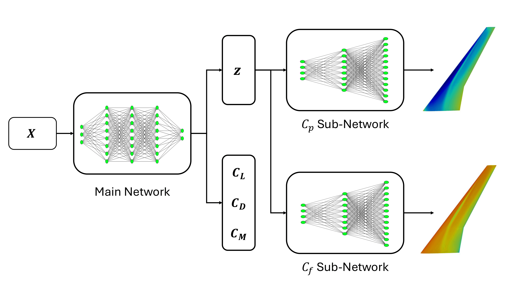

# Transonic wing aerodynamic analysis and uncertainty quantification using multi-task deep learning

This repository provides an open-source implementation of the multi-task surrogate models and hyperparameter optimization methods introduced in the work titled "**Transonic wing aerodynamic analysis and uncertainty quantification using multi-task deep learning**". This can be used to reproduce the results presented in the paper and use the methods for further research and development.

## Multi-task Aerodynamics Net (MTAeroNet)

This work introduces the Multi-task Aerodynamics Net (MTAeroNet) surrogate modeling architecture, which has a main network to predict integrated aerodynamic quantities along with a set of latent variables and the latent variables are then provided to multiple sub-networks to predict various surface quantities for a three-dimensional body in transonic flow. A graphical overview of the modeling architecture is shown in the diagram below. In this implementation and work, each sub-network and the main network of the modeling architecture are MLP networks. This is done to promote simplicity within the modeling architecture while still maintaining prediction accuracy. 

<table>
  <tr>
    <td></td>
    <td></td>
  </tr>
</table>

## Multiobjective Hyperparameter Optimization

This work also introduces a multiobjective optimization problem formulation for selecting the optimal hyperparameters for multi-task aerodynamic surrogate models. There are two objectives in the problem formulation. One objective is the mean of the normalized root mean square errors (NRMSE) of the scalar aerodynamic quantities of interest, and the other objective is the mean NRMSE in the surface quantities across the surface of the three-dimensional body in transonic flow. An open-source implementation of this formulation and its solution procedure is provided, which uses Optuna and Bayesian optimization with Tree-structured Parzen estimators to solve the optimization problem. Additionally, single objective optimization problem formulations and an implementation of their solution through Optuna is also provided for models that are not multi-task in nature but are also investigated in the work.  

# NASA common research model wing dataset

The aerodynamic data used to construct and train the models used within this work has been provided in an open-source format on Hugging Face. This is to promote reusability of the results and also provide the dataset as a general means to train and benchmark aerodynamic ML models for transonic flow. If you would like to access the data, please visit the following Hugging Face dataset.

Hugging Face Dataset: [https://huggingface.co/datasets/computationaldesignlab/nasa-crm-wing-data](https://huggingface.co/datasets/computationaldesignlab/nasa-crm-wing-data)

To use the dataset files along with this code, all quantities of interest must be consolidated and format into `.mat` files containing dictionaries of `numpy` arrays with the following keys:
- `x`: This should be an array containing operating conditions and spanwise twist angles.
- `coeff`: This should be an array containing scalar quantities of interest for the CRM wing.
- `coefPressure`: This should be an array containing the surface pressure coefficient distributions of the CRM wing.
- `skinFriction`: This should be an array containing the surface skin friction magnitude distributions of the CRM wing.

The `.mat` files should be stored in a folder named `data` within the same directory as the runscripts as per the current version of the scripts. However, the file paths for the `.mat` files can be changed to the desired file paths before running the runscripts. This must be done at every location there is a call to the `loadmat` function.  

# Installation and setup

The best way to run the implementation is through a conda environment. Miniconda is the recommended way to create a new conda environment with a Python installation that has a version of at least 3.12. Follow the steps below to create the new conda environment and use this implementation. 

1. Create a new conda environment and activate it.

   `conda create -n your_env python=3.12`

2. Download the latest release of the code as a zip file and include it in your working directory.

3. Install the following required packages for the environment using `pip`.

* PyTorch (2.12.1 and CUDA support is desirable)
* Numpy (2.4.4)
* Scipy (1.17.1)
* Optuna (4.9.0)
* Scikit-learn (1.8.0)

The relevant code and implementations for the methods are located in the `src` folder in the repo. Individual runscripts for the hyperparameter optimization, model evaluation and uncertainty quantification are also provided to run the models on the wing geometry dataset with ease. In the `src` folder, the `MTAeroNet` class corresponds to the MTAeroNet - Cp model and the `MHAeroNet` class corresponds to the MTAeroNet - Cp and Cf model from the paper.    

# Running the code

The code to train and evalaute the models can be run using a few simple commands from a terminal or in a jobscript on a high-performance computing environment. These commands must be run from the root directory of the code that can be downloaded from the latest release.  

1. Running the hyperparameter optimization script. This requires specifying the number of training samples to be used for the model, the modeling method, the type of optimization, the number of trials and the random seed. In the associated publication, the seed values from 1 to 5 are used to run 5 different sets of the optimization. An example of the running command for this script is given below.

   `python runscript_hpo_crm_wing.py --samples 50 --method "mhaero" --type "multi" --trials 450 --seed 1`
   
2. Running the model prediction/evaluation script. This requires specifying the number of training samples to be used for the model and the method. The script runs the training with 10 different random initializations and using the results from all 5 hyperparameter sets leading to a total of 50 model evaluations. The training seeds used are from 0 to 9. An example of the running command for this script is given below.

   `python runscript_prediction_crm_wing.py --samples 50 --method "mhaero"`

3. Running the uncertainty quantification script. This only requires specifying the number of training samples used to train the model, as by default this runs the MTAeroNet - Cp and Cf model (which corresponds to the MHAeroNet class). An example of the running command for this script is given below. 

   `python runscript_uq_crm_wing.py --samples 50`

# Citation 

If you find this research and associated data useful, please cite the following paper. We welcome any opportunities for collaborating on future extensions of this work. 

(Paper is currently submitted and this will be updated in the future). 

